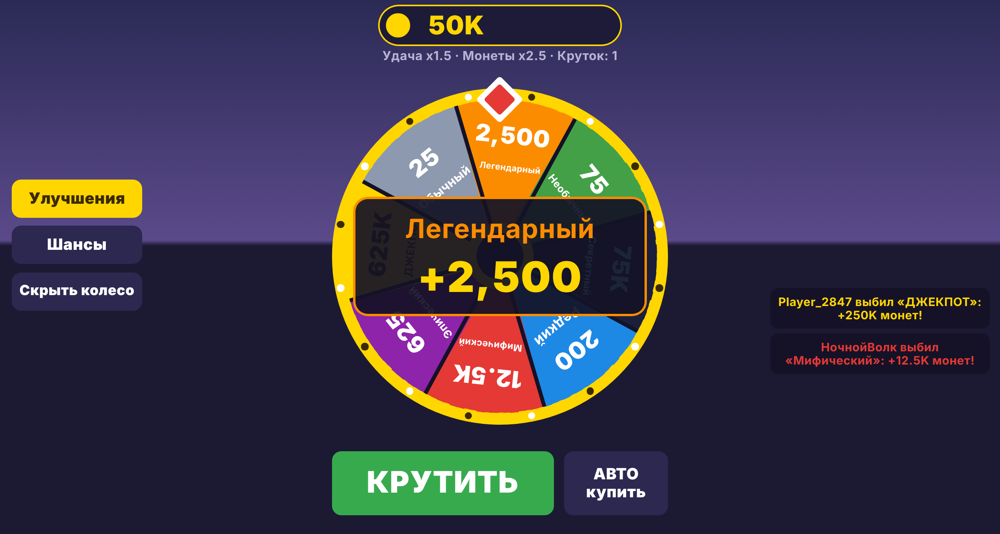
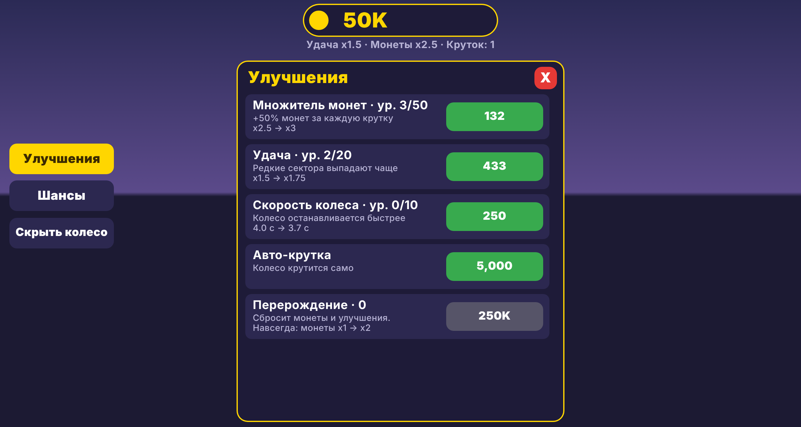

# Крути и выигрывай — игра для Roblox

Колесо удачи: крутишь, выигрываешь монеты, покупаешь улучшения, перерождаешься и ловишь редкие сектора.
Готовый файл игры лежит в `build/SpinAndWin.rbxlx` — его можно сразу открыть в Roblox Studio.




Картинки отрисованы вне Roblox по настоящему дереву интерфейса игры, поэтому шрифт в Studio будет немного другим.

## Почему приз — монеты, а не робуксы

Игра не может выдать игроку робуксы: у Roblox нет такой возможности, а обещание «бесплатных робуксов» модерация
считает обманом и блокирует игру. Платная крутка с призом в робуксах — азартная игра, она тоже запрещена.

Робуксы здесь зарабатывает автор игры — через геймпассы (см. ниже).

## Как запустить

1. Установите [Roblox Studio](https://create.roblox.com/) (Windows или Mac).
2. Скачайте `build/SpinAndWin.rbxlx` и откройте его в Studio.
3. Нажмите **Play**. Крутить можно кнопкой «КРУТИТЬ» или клавишей **E**.

В Studio появится предупреждение «Сохранения сейчас недоступны» — это нормально, пока игра не опубликована.

## Как опубликовать

1. В Studio: **File → Publish to Roblox**, задайте название и описание.
2. Чтобы сохранения работали и при тесте в Studio: **Game Settings → Security → Enable Studio Access to API Services**.
3. В Creator Dashboard сделайте игру публичной.

Название вроде «Крути и получи робуксы» лучше не использовать — за него игру могут заблокировать.

## Как зарабатывать: геймпассы

1. В Creator Dashboard откройте игру → **Monetization → Passes** и создайте пассы.
2. Скопируйте ID каждого пасса.
3. В Studio откройте `ReplicatedStorage → Shared → Config` и впишите ID в `Config.GamePasses`:
   - `doubleCoins` — удваивает все выигрыши;
   - `doubleLuck` — удваивает удачу;
   - `autoSpin` — сразу даёт авто-крутку.

Пока ID равен `0`, пасс в игре не показывается.

## Что настраивается

Все числа лежат в одном файле — `src/shared/Config.luau` (в Studio: `ReplicatedStorage → Shared → Config`):

| Что | Где |
| --- | --- |
| Сектора: названия, цвета, шансы, множители | `Config.Segments` |
| Порядок секторов на колесе | `Config.WheelOrder` |
| Цены и пределы улучшений | `Config.Upgrades` |
| Цена и бонус перерождения | `Config.RebirthBaseCost`, `Config.RebirthCostGrowth`, `Config.RebirthBonus` |
| Скорость колеса | `Config.BaseSpinTime`, `Config.MinSpinTime` |
| Звуки (ID из Toolbox) | `Config.Sounds` |

Шансы секторов в сумме должны давать 100. Игрок видит настоящие шансы в панели «Шансы».

## Как устроено

| Папка | Что внутри |
| --- | --- |
| `src/shared` | Настройки и логика колеса — общие для сервера и клиента |
| `src/server` | Выбор сектора, начисление монет, сохранения, геймпассы, постройка лобби |
| `src/client` | Интерфейс: колесо, кнопки, панели |
| `tests` | Проверка игры без Studio |
| `build` | Собранный файл игры |

Сектор выбирает сервер, клиент только показывает анимацию, поэтому накрутить монеты читами нельзя.
Лобби собирается скриптом из простых деталей при запуске — в режиме редактирования видны только пол и спавн.

## Разработка

Нужны [Rojo](https://rojo.space/) и, для тестов, [Lune](https://lune-org.github.io/docs).

```
rojo build -o build/SpinAndWin.rbxlx   # собрать файл игры
rojo serve                             # живая синхронизация с открытой Studio (нужен плагин Rojo)
lune run tests/smoke                   # проверка: логика, крутка, улучшения, перерождение, сохранения
lune run tests/smoke -- --passes       # то же с включёнными геймпассами
lune run tests/smoke -- --nostore      # игра без доступа к сохранениям
```

Тесты запускают настоящие скрипты из собранного файла в эмуляторе и ловят ошибки в логике и опечатки
в свойствах объектов. В самой Studio игра ещё не запускалась: физику, освещение и точный вид
интерфейса нужно посмотреть там.
